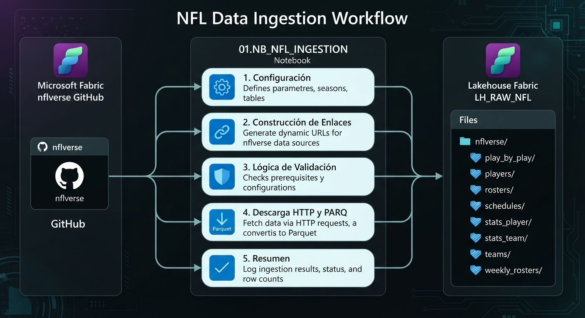

# NB_NFL_INGESTION

## Descripción

Notebook encargado de realizar la ingesta de datos históricos y actualizados de [nflverse](https://github.com/nflverse/nflverse-data) hacia el Lakehouse `LH_RAW_NFL` de Microsoft Fabric.

Su objetivo es centralizar la descarga de los conjuntos de datos disponibles en formato Parquet y almacenarlos en la zona RAW, conservando su estructura y contenido original, sin aplicar transformaciones.

## Flujo de ejecución



El notebook está organizado en cinco etapas:

1. **Configuración:** define las fuentes de datos, los parámetros de descarga, la temporada de referencia y la ruta de almacenamiento.
2. **Construcción de enlaces:** genera las URL correspondientes a los archivos disponibles en nflverse.
3. **Validación:** determina qué archivos necesitan descargarse y cuáles pueden conservarse según las reglas de actualización establecidas.
4. **Descarga y almacenamiento:** obtiene los archivos mediante solicitudes HTTP, valida su integridad y los guarda en el Lakehouse.
5. **Resumen de ejecución:** presenta los resultados del proceso, incluyendo descargas exitosas, archivos omitidos, recursos no encontrados y errores.

## Características

- **Carga histórica:** permite obtener los datos desde los años de inicio definidos para cada conjunto de datos.
- **Ingesta incremental:** evita descargar nuevamente los archivos históricos que ya existen y no requieren actualización.
- **Actualización periódica:** contempla la renovación de conjuntos de datos que pueden cambiar durante la temporada.
- **Formato Parquet:** conserva los archivos en un formato columnar compatible con Apache Spark y Microsoft Fabric.
- **Validación de integridad:** comprueba características básicas de los archivos descargados antes de almacenarlos en su ubicación definitiva.

## Ubicación de los datos

Los archivos se almacenan en el Lakehouse `LH_RAW_NFL`, dentro de la siguiente estructura:

```text
Files/
└── nflverse/
    ├── play_by_play/
    ├── rosters/
    ├── weekly_rosters/
    ├── stats_player/
    ├── stats_team/
    ├── schedules/
    ├── players/
    └── teams/
```

## Ejecución

El notebook debe ejecutarse en Microsoft Fabric con `LH_RAW_NFL` configurado como Lakehouse predeterminado.

Puede utilizarse tanto para la carga histórica inicial como para ejecuciones posteriores destinadas a incorporar actualizaciones de los datos.

**Nota:** las reglas de actualización están definidas por conjunto de datos. Los archivos históricos existentes no se vuelven a descargar automáticamente si no cumplen las condiciones establecidas en el proceso.

## Fuente de datos

- [nflverse-data - GitHub](https://github.com/nflverse/nflverse-data)
- [nflverse - Documentación](https://nflverse.nflverse.com/)
