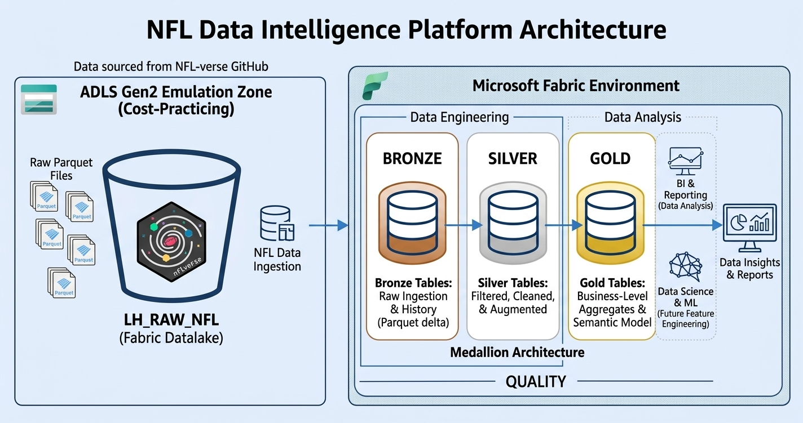

# 🏈 NFL Data Intelligence Platform

**Plataforma integral de ingeniería de datos y analítica deportiva, desarrollada con Microsoft Fabric, cuyo objetivo es ingerir, organizar, transformar y analizar datos de la NFL para desarrollar modelos predictivos de resultados de partidos.**

<p align="center">
  
</p>

<p align="center">
  <strong>Microsoft Fabric · OneLake · PySpark · Parquet · Arquitectura Medallion · Machine Learning</strong>
</p>

---

## 📌 Descripción del proyecto

**NFL Data Intelligence Platform** es un proyecto personal de ingeniería de datos enfocado en construir una plataforma modular utilizando Microsoft Fabric.

El proyecto utiliza como fuente principal los conjuntos de datos publicados por [nflverse](https://github.com/nflverse/nflverse-data). Estos conjuntos contienen información histórica y datos organizados por temporada que pueden ser ingeridos, procesados y transformados en estructuras analíticas.

La plataforma está diseñada alrededor de dos espacios de trabajo independientes en Microsoft Fabric:

1. **LH_RAW_NFL:** entorno de ingesta y almacenamiento inicial de datos originales.
2. **LH_NFL_PLATFORM:** plataforma principal de procesamiento, donde se implementará la Arquitectura Medallion, las transformaciones analíticas, la ingeniería de características y los flujos de Machine Learning.

Esta separación es intencional. En lugar de combinar la ingesta y las transformaciones en un único entorno, el proyecto sigue un diseño modular que reproduce conceptualmente la separación entre una capa de almacenamiento de datos y una plataforma de procesamiento.

El caso de uso analítico se centra en el análisis de partidos de la NFL y el desarrollo de modelos predictivos, con especial interés en los Green Bay Packers.

---

## 🏗️ Diseño de la arquitectura

### 1. Zona de almacenamiento e ingesta: LH_RAW_NFL

El primer espacio de trabajo está diseñado para funcionar como una zona independiente de ingesta y almacenamiento de datos.

Su propósito arquitectónico es **emular la función de almacenamiento que desempeñaría un Azure Data Lake Storage Gen2 (ADLS Gen2)**, utilizando Microsoft Fabric OneLake como servicio de almacenamiento subyacente.

Es importante aclarar que se trata de una emulación conceptual y no de un despliegue real de Azure Data Lake Storage Gen2.

La razón para implementar esta capa por separado es reproducir un patrón habitual en las plataformas de datos en la nube: mantener separadas las responsabilidades de ingesta y almacenamiento de datos originales respecto de los procesos posteriores de transformación.

**Responsabilidades principales:**

- Obtener conjuntos de datos desde nflverse.
- Descargar y almacenar los archivos originales en formato Parquet.
- Organizar los archivos por fuente y categoría de datos.
- Conservar los datos de origen antes de aplicar transformaciones de negocio.
- Realizar verificaciones básicas de integridad de archivos y descargas.
- Poner los datos ingeridos a disposición del entorno de procesamiento.

La ingesta busca preservar los datos originales tal como son recibidos. La limpieza de negocio, normalización, estandarización y validación de calidad corresponden a las etapas posteriores, no a la zona de almacenamiento RAW.

**¿Por qué Parquet?**

Se seleccionó Parquet por ser un formato columnar adecuado para cargas analíticas y compatible con Apache Spark y Microsoft Fabric.

Además, permite almacenar y procesar conjuntos de datos estructurados de manera eficiente frente a formatos tradicionales orientados a filas, como CSV.

### 2. Plataforma de procesamiento: LH_NFL_PLATFORM

El segundo espacio de trabajo contiene la plataforma de ingeniería de datos y analítica.

Consumirá los conjuntos de datos originales almacenados en `LH_RAW_NFL` mediante **OneLake Shortcuts**.

Los Shortcuts permiten acceder a datos almacenados en otra ubicación de OneLake sin tener que generar una segunda copia física de los archivos originales.

Esto permite que el entorno de procesamiento acceda a la zona RAW, manteniendo separadas las responsabilidades de ingesta y transformación.

La arquitectura de procesamiento seguirá el modelo **Medallion Architecture**:

| Capa | Responsabilidad |
|---|---|
| Bronze | Persistir los datos ingeridos como tablas Delta iniciales, conservando la información de origen. |
| Silver | Limpiar, validar, estandarizar y transformar los datos en conjuntos consistentes. |
| Gold | Construir conjuntos orientados al análisis, agregaciones y modelos analíticos. |

Después de la capa Gold se desarrollarán procesos de ingeniería de características (*Feature Engineering*) y flujos de Machine Learning.

**¿Por qué separar los espacios de trabajo?**

Esta decisión arquitectónica aporta varios beneficios:

- **Separación de responsabilidades:** la ingesta y la transformación cumplen funciones diferentes.
- **Menor duplicación de datos:** los OneLake Shortcuts permiten acceder a los datos originales sin copiar nuevamente los archivos.
- **Modularidad:** cada espacio de trabajo puede evolucionar de forma independiente.
- **Mantenibilidad:** los cambios en la lógica de ingesta no necesitan mezclarse con las transformaciones.
- **Escalabilidad:** la arquitectura proporciona una base para incorporar más conjuntos de datos y cargas analíticas.

---

## 🔄 Flujo de datos

El flujo de datos previsto es el siguiente:

```text
                    FUENTE EXTERNA
                         |
                         v
                +-------------------+
                |      nflverse     |
                |   Datos de la NFL |
                +-------------------+
                         |
                         v
             +-------------------------+
             |       LH_RAW_NFL        |
             |                         |
             |   Ingesta de datos      |
             |   Archivos Parquet      |
             |   Almacenamiento RAW    |
             +-------------------------+
                         |
                         |
                  OneLake Shortcut
                         |
                         v
             +-------------------------+
             |    LH_NFL_PLATFORM     |
             |                         |
             |       BRONZE            |
             |          |              |
             |       SILVER            |
             |          |              |
             |        GOLD             |
             |          |              |
             |  Feature Engineering   |
             |          |              |
             |    Machine Learning     |
             +-------------------------+
                         |
                         v
                Analítica NFL y
              modelos predictivos
```

La idea central es mantener un límite claro entre el entorno de almacenamiento de datos originales y el entorno de procesamiento analítico.

La capa RAW se encarga de poner los datos de origen a disposición de la plataforma. La capa de procesamiento se encarga de convertir esos datos en información confiable y útil.

---

## 📥 Fuente de datos

La fuente principal del proyecto es [nflverse-data](https://github.com/nflverse/nflverse-data), un repositorio de código abierto que publica conjuntos de datos de la NFL mediante lanzamientos automatizados.

El proyecto obtiene los conjuntos de datos directamente desde sus publicaciones oficiales, evitando depender exclusivamente de archivos descargados manualmente.

**Recursos oficiales:**

- [Organización nflverse](https://github.com/nflverse)
- [Repositorio nflverse-data](https://github.com/nflverse/nflverse-data)
- [Publicaciones y archivos disponibles](https://github.com/nflverse/nflverse-data/releases)

### Conjuntos de datos iniciales

La capa de ingesta está diseñada para obtener diferentes categorías de información de la NFL:

| Conjunto de datos | Propósito |
|---|---|
| Play-by-play | Información detallada de cada jugada. |
| Rosters | Información de las plantillas de jugadores por temporada. |
| Weekly Rosters | Información semanal de jugadores y disponibilidad en las plantillas. |
| Player Weekly Statistics | Estadísticas de rendimiento de jugadores por semana. |
| Team Weekly Statistics | Estadísticas de rendimiento de equipos por semana. |
| Schedules | Calendarios y resultados de partidos. |
| Players | Información de referencia de jugadores. |
| Teams | Información de referencia de equipos. |

La disponibilidad de información histórica y de la temporada actual depende de las publicaciones y actualizaciones de las fuentes originales.

**Atribución de datos:** el uso y la atribución de los conjuntos de datos de terceros deberán respetar las condiciones establecidas por nflverse y por los proveedores correspondientes. La licencia MIT de este repositorio se aplica al código desarrollado para este proyecto, no automáticamente a los datos de terceros.

---

## 🧰 Tecnologías utilizadas

| Tecnología | Aplicación dentro del proyecto |
|---|---|
| Microsoft Fabric | Entorno de ingeniería de datos y analítica en la nube. |
| OneLake | Almacenamiento unificado para los espacios de trabajo. |
| OneLake Shortcuts | Acceso a los datos RAW desde el entorno de procesamiento sin duplicar los archivos originales. |
| Python | Ingesta, automatización y scripts auxiliares. |
| Requests | Solicitudes HTTP y descarga de archivos. |
| Parquet | Formato columnar para almacenar los conjuntos de datos originales. |
| Apache Spark / PySpark | Procesamiento distribuido y transformaciones. |
| Delta Lake | Formato de almacenamiento de tablas para las capas Medallion. |
| Git y GitHub | Control de versiones y documentación. |
| Machine Learning | Desarrollo y evaluación de modelos predictivos. |

La implementación de cada tecnología y flujo de trabajo se documentará a medida que avance el desarrollo.

---

## 📂 Estructura del repositorio

```text
NFL-Data-Intelligence-Platform/
│
├── LH_RAW_NFL/
│   ├── notebooks/
│   ├── scripts/
│   └── README.md
│
├── LH_NFL_PLATFORM/
│   ├── notebooks/
│   │   ├── bronze/
│   │   ├── silver/
│   │   ├── gold/
│   │   ├── feature_engineering/
│   │   └── machine_learning/
│   │
│   ├── pipelines/
│   ├── sql/
│   └── README.md
│
├── docs/
│   ├── img/
│   │   └── nfl_data_intelligence_platform_architecture.png
│   ├── architecture.md
│   ├── data_sources.md
│   └── data_dictionary.md
│
├── .gitattributes
├── .gitignore
├── LICENSE
└── README.md
```

*Esta estructura representa la organización prevista del proyecto. Los directorios y componentes se irán completando conforme se implementen las diferentes etapas.*

---

## 🎯 Objetivos del proyecto

El proyecto tiene dos objetivos complementarios.

### Ingeniería de datos

- Construir un proceso modular de ingesta de datos.
- Separar el almacenamiento de datos originales de los procesos de transformación.
- Trabajar con archivos Parquet y almacenamiento columnar.
- Implementar OneLake Shortcuts entre espacios de trabajo de Fabric.
- Desarrollar una Arquitectura Medallion con las capas Bronze, Silver y Gold.
- Implementar controles de calidad y flujos de transformación.
- Organizar la plataforma para permitir ingestas incrementales y futuras ampliaciones.

### Analítica NFL y Machine Learning

- Analizar partidos históricos y el rendimiento de los equipos.
- Explorar estadísticas de jugadores y equipos.
- Construir conjuntos de datos analíticos a nivel de partido.
- Desarrollar características predictivas relevantes.
- Entrenar y evaluar modelos de Machine Learning.
- Explorar los factores que influyen en los resultados de los partidos de la NFL.
- Desarrollar modelos predictivos con especial interés en los partidos de Green Bay Packers.

El rendimiento de los modelos se medirá mediante métricas de evaluación y validación histórica. No se presupone ningún porcentaje de precisión antes de realizar las pruebas.

---

## 🚧 Hoja de ruta de desarrollo

El proyecto se desarrolla de forma incremental.

| Fase | Descripción | Estado |
|---|---|---|
| 01 | Diseño de arquitectura y organización del repositorio | En progreso |
| 02 | Ingesta de datos originales mediante Python y nflverse | En progreso |
| 03 | Almacenamiento de archivos Parquet en LH_RAW_NFL | En progreso |
| 04 | Integración mediante OneLake Shortcuts | Planificado |
| 05 | Implementación de la capa Bronze | Planificado |
| 06 | Transformaciones y controles de calidad en Silver | Planificado |
| 07 | Capa Gold y conjuntos de datos analíticos | Planificado |
| 08 | Ingeniería de características | Planificado |
| 09 | Desarrollo de modelos de Machine Learning | Planificado |
| 10 | Evaluación de modelos y análisis predictivo | Planificado |

La hoja de ruta se actualizará conforme cada etapa sea implementada y validada.

---

## 📚 Documentación

La documentación técnica adicional se mantendrá dentro del directorio `docs/`.

- **Arquitectura:** explicación detallada de la separación de espacios de trabajo, el diseño de almacenamiento y el flujo de datos.
- **Fuentes de datos:** procedencia de los conjuntos de datos, formatos, frecuencia de actualización y atribución.
- **Diccionario de datos:** descripción de las tablas, columnas y definiciones relevantes.

---

## ⚖️ Licencia y atribución de datos

El código fuente de este repositorio se distribuye bajo la licencia MIT, según lo establecido en el archivo `LICENSE`.

Los conjuntos de datos de terceros no quedan automáticamente cubiertos por esta licencia. Su utilización, atribución y redistribución deberán cumplir las condiciones aplicables establecidas por nflverse y por los proveedores individuales.

Fuente: [nflverse-data](https://github.com/nflverse/nflverse-data).

---

## 👨‍💻 Autor

**Erick**  
Tecnólogo en Software | Junior Data Engineering

GitHub: [@index3RICK](https://github.com/index3RICK)

---

<p align="center">
  <strong>Construyendo una plataforma modular de datos de la NFL, capa por capa.</strong>
</p>
